# cdc-pipeline

[](https://github.com/Oppen-OC/cdc-pipeline/actions/workflows/ci.yml)

Los cambios de PostgreSQL se capturan del WAL con Debezium, se transportan por
Redis Streams, los enriquece un procesador Python, se materializan en un
esquema analítico y se sirven con FastAPI, en pocos segundos y sin tocar la
aplicación de origen.


## Arquitectura

```mermaid
flowchart LR
    subgraph source["Capa de origen"]
        PG[("PostgreSQL 15<br/>public.products")]
    end

    subgraph ingest["Ingesta — CDC basado en log"]
        DBZ["Debezium Server 2.5.4<br/>PostgresConnector"]
        RDS[("Redis 7<br/>stream inventory.public.products")]
    end

    subgraph process["Procesamiento — streaming"]
        PROC["processor<br/>XREADGROUP + UPSERT idempotente"]
    end

    subgraph storage["Almacenamiento — tabla de servicio"]
        ANA[("PostgreSQL 15<br/>analytics.products_enriched")]
    end

    subgraph serve["Exposición"]
        API["FastAPI + uvicorn<br/>:8000"]
    end

    CLIENT(["Cliente / curl"])

    PG -->|"replicación lógica<br/>slot, pgoutput"| DBZ
    DBZ -->|"XADD, eventos de cambio en JSON"| RDS
    RDS -->|"XREADGROUP, consumer group"| PROC
    PROC -->|"INSERT ... ON CONFLICT"| ANA
    ANA -->|"SELECT, pool de conexiones"| API
    API -->|"HTTP, JSON"| CLIENT
```



Desglose completo de componentes, flujo de datos y decisiones:
**[docs/architecture.md](./docs/architecture.md)**.

## Stack

| Capa | Tecnología |
| --- | --- |
| Ingesta | Debezium Server 2.5.4: CDC basado en log, sin clúster de Kafka |
| Transporte | Redis 7 streams con consumer groups |
| Procesamiento | Python 3.11, consumidor de streaming en tiempo real |
| Almacenamiento | PostgreSQL 15, esquema `analytics` |
| Exposición | FastAPI 0.109 + uvicorn, REST/JSON |
| Despliegue | Docker Compose, cinco servicios |

## Arranque rápido

Requiere Docker y Docker Compose. Nada más: Python se ejecuta dentro de los
contenedores.

```bash
docker compose up -d --build
docker compose ps          # cinco servicios, postgres, redis y api healthy
```

`cp .env.example .env` para cambiar credenciales (opcional). Solo surte efecto
con el volumen de PostgreSQL vacío: antes del primer arranque o tras
`docker compose down -v`.

Los esquemas (`public.products` y `analytics.products_enriched`) se crean solos
en el primer arranque con los scripts de `sql/init/`. Solo se ejecutan con el
volumen vacío; para reinicializar, `docker compose down -v`.

Antes de la demo hay que esperar a que Debezium tenga el slot de replicación
activo; si no, los cambios anteriores se pierden. Repite el comando hasta que
devuelva `t`:

```bash
docker exec postgres_source psql -U postgres -d inventory_db -tAc "SELECT active FROM pg_replication_slots WHERE slot_name='debezium'"
```

Generar los primeros eventos de cambio:

```bash
docker exec -i postgres_source psql -U postgres -d inventory_db -v ON_ERROR_STOP=1 < sql/demo-mutations.sql
sleep 10
curl -s localhost:8000/products   # solo el id 1, con price 22.99
```

```
[{"id":1,"name":"Wireless Mouse","description":"Ergonomic 2.4G mouse","price":22.99,"price_with_vat":27.82,"category":"Peripherals","created_at":"2026-11-12T17:33:55.930210Z","last_op":"u","is_deleted":false,"ingested_at":"2026-11-12T17:33:56.518699Z"}]
```

El id 2 (Mechanical Keyboard) se borró en la demo, así que la API no lo lista.

Ver cómo fluyen:

```bash
docker logs -f cdc_processor
```

```
2026-11-12 17:33:45,093 INFO  consumer group 'analytics-processor' created on stream 'inventory.public.products'
2026-11-12 17:33:45,099 INFO  connected to postgres at postgres:5432
2026-11-12 17:33:45,099 INFO  processing stream 'inventory.public.products' as consumer 'processor-1'
2026-11-12 17:33:56,513 INFO  op=c id=1 lsn=26513424 applied=True
2026-11-12 17:33:56,516 INFO  op=c id=2 lsn=26513744 applied=True
2026-11-12 17:33:56,519 INFO  op=u id=1 lsn=26513976 applied=True
2026-11-12 17:33:56,521 INFO  op=d id=2 lsn=26514208 applied=True
```

Para comprobar todo el recorrido (Postgres, Debezium, Redis, procesador y API) de una vez, `bash scripts/e2e.sh`; es la misma prueba que ejecuta el CI. Requiere partir de un entorno limpio: ejecuta antes `docker compose down -v`. Deja el stack levantado.

Para parar y limpiar: `docker compose down -v`.

## API

Documentación interactiva, con los esquemas de respuesta, en
**http://localhost:8000/docs**.

| Método | Ruta | Descripción |
| --- | --- | --- |
| GET | `/health` | Estado del servicio con una comprobación real contra la base de datos; `503` si PostgreSQL no responde. |
| GET | `/products` | Estado actual de los productos. Parámetros: `limit` (1-500), `offset`, `include_deleted`, `category`. |
| GET | `/products/{id}` | Un producto concreto; `404` si no existe. |
| GET | `/stats` | Agregados: totales, activos/eliminados, estadísticas de precio y desglose por categoría. |

Con el stack arrancado (`docker compose ps` con `api` healthy) y los eventos de
la demo ya procesados:

```bash
curl -s localhost:8000/health
curl -s localhost:8000/products
curl -s "localhost:8000/products?include_deleted=true&limit=10"
curl -s "localhost:8000/products?category=Displays"
curl -s localhost:8000/products/1
curl -s localhost:8000/stats
```

En PowerShell de Windows usa `curl.exe`: el `curl` a secas es un alias de
`Invoke-WebRequest` y no acepta esta sintaxis.

## Qué demuestra

Los cuatro ejemplos siguientes continúan, en orden, desde el arranque rápido
(`docker compose down -v`, `docker compose up -d --build`, esperar al slot y
ejecutar `sql/demo-mutations.sql`): la demo deja los ids 1 y 2, así que el
producto nuevo recibe el id 3. Las salidas son reales, de una ejecución de este
repo; los LSN, las marcas de tiempo y el orden pueden variar en la tuya.
`scripts/e2e.sh` comprueba automáticamente las afirmaciones de los tres
primeros apartados.

### El pipeline es en vivo, no por lotes

Se escribe en la tabla de origen y se consulta la API; no se toca nada más:

```bash
docker exec postgres_source psql -U postgres -d inventory_db -c \
  "INSERT INTO products (name, description, price) VALUES ('4K Monitor', '27 inch IPS panel', 329.00);"
sleep 3
curl -s localhost:8000/products/3
```

```
{"id":3,"name":"4K Monitor","description":"27 inch IPS panel","price":329.0,"price_with_vat":398.09,"category":"Displays","created_at":"2026-11-12T17:34:16.989390Z","last_op":"c","is_deleted":false,"ingested_at":"2026-11-12T17:34:17.574550Z"}
```

La fila nueva llega con el IVA calculado (`price_with_vat`) y una categoría
derivada de su nombre, tras atravesar el WAL, Debezium, Redis y el procesador.

### Los borrados son lógicos (soft deletes)

```bash
docker exec postgres_source psql -U postgres -d inventory_db -c "DELETE FROM products WHERE id = 3;"
sleep 3
curl -s localhost:8000/products/3   # sigue ahí, marcado como borrado
curl -s localhost:8000/products     # desaparece del listado
```

```
{"id":3,"name":"4K Monitor","description":"27 inch IPS panel","price":329.0,"price_with_vat":398.09,"category":"Displays","created_at":"2026-11-12T17:34:16.989390Z","last_op":"d","is_deleted":true,"ingested_at":"2026-11-12T17:34:21.084254Z"}
[{"id":1,"name":"Wireless Mouse","description":"Ergonomic 2.4G mouse","price":22.99,"price_with_vat":27.82,"category":"Peripherals","created_at":"2026-11-12T17:33:55.930210Z","last_op":"u","is_deleted":false,"ingested_at":"2026-11-12T17:33:56.518699Z"}]
```

El id 3 conserva su fila con `"is_deleted":true`; solo el listado por defecto
la oculta (`?include_deleted=true` la devuelve).

### La reentrega no puede corromper los datos

Se rebobina el consumer group y se deja que el procesador reprocese todo el
stream. Se muestra `ingested_at` del id 1 antes y después:

```bash
curl -s localhost:8000/products/1 | grep -o '"ingested_at":"[^"]*"'
docker exec redis_sink redis-cli XGROUP SETID inventory.public.products analytics-processor 0
sleep 5
docker logs --tail 6 cdc_processor
curl -s localhost:8000/products/1 | grep -o '"ingested_at":"[^"]*"'
```

```
"ingested_at":"2026-11-12T17:33:56.518699Z"
OK
2026-11-12 17:34:31,214 INFO  op=c id=1 lsn=26513424 applied=False
2026-11-12 17:34:31,217 INFO  op=c id=2 lsn=26513744 applied=False
2026-11-12 17:34:31,220 INFO  op=u id=1 lsn=26513976 applied=False
2026-11-12 17:34:31,223 INFO  op=d id=2 lsn=26514208 applied=False
2026-11-12 17:34:31,225 INFO  op=c id=3 lsn=26794880 applied=False
2026-11-12 17:34:31,228 INFO  op=d id=3 lsn=26795536 applied=False
"ingested_at":"2026-11-12T17:33:56.518699Z"
```

La guarda por LSN rechaza todos los eventos (`applied=False`) y la marca
`ingested_at` no se modifica. Entrega at-least-once, efecto exactly-once.

### No se pierde nada mientras el procesador está caído

Se actualiza una fila existente (el id 1) con el procesador parado; el evento
espera en el stream y se aplica al volver:

```bash
docker compose stop processor
docker exec postgres_source psql -U postgres -d inventory_db -c \
  "UPDATE products SET price = 39.90 WHERE id = 1;"
sleep 5
docker exec redis_sink redis-cli XINFO GROUPS inventory.public.products | grep -A1 '^lag'   # lag 1: un evento esperando
docker compose start processor
sleep 8
docker exec redis_sink redis-cli XINFO GROUPS inventory.public.products | grep -A1 '^lag'   # lag 0: puesto al día
curl -s localhost:8000/products/1
```

```
lag
1
lag
0
{"id":1,"name":"Wireless Mouse","description":"Ergonomic 2.4G mouse","price":39.9,"price_with_vat":48.28,"category":"Peripherals","created_at":"2026-11-12T17:33:55.930210Z","last_op":"u","is_deleted":false,"ingested_at":"2026-11-12T17:34:48.215528Z"}
```

## Decisiones de diseño

* **Redis Streams en lugar de Kafka**: un único contenedor ligero, sin clúster
  de brokers, y aun así con consumer groups y confirmación (ack) por mensaje.
* **Idempotencia por LSN**: cada fila guarda la posición del WAL que la produjo
  y el UPSERT ignora cualquier evento que no sea estrictamente más reciente.
* **Commit antes del acknowledge**: un fallo provoca una reentrega, no una
  pérdida.
* **Soft deletes**: la capa analítica conserva el historial.
* **`table.include.list`**: evita que las escrituras del propio procesador se
  capturen y reprocesen en bucle.
* **Endpoints síncronos con pool de conexiones**, porque psycopg2 es bloqueante.

Cada una se explica en
[docs/architecture.md](./docs/architecture.md#decisiones-de-diseño).

## Limitaciones conocidas

* Origen y servicio comparten la misma instancia de PostgreSQL; un despliegue
  real separaría OLTP de analítica.
* El procesador es un único consumidor; escalarlo exigiría orden por clave.
* El slot de replicación nunca se elimina: si Debezium se detiene mucho tiempo,
  el WAL crece hasta que se vuelva a consumir.
* La API no tiene autenticación; un despliegue público la necesitaría.

Detalle en [docs/architecture.md](./docs/architecture.md#limitaciones-conocidas).

## Estructura del repo

```
.
├── docker-compose.yml                    # todo el stack
├── .github/workflows/ci.yml              # CI: lint, tests unitarios y prueba e2e
├── LICENSE                               # licencia MIT
├── .env.example                          # credenciales configurables (copiar a .env)
├── scripts/e2e.sh                        # prueba end-to-end del pipeline completo
├── debezium-conf/application.properties  # configuración de origen y sink del CDC
├── sql/
│   ├── init/                             # se ejecuta solo en el primer arranque
│   │   ├── 01-source-schema.sql          # tabla de origen (public.products)
│   │   └── 02-analytics-schema.sql       # tabla de servicio (idempotente)
│   └── demo-mutations.sql                # INSERT/UPDATE/DELETE de demostración
├── processor/
│   ├── consumer.py                       # stream de Redis -> tabla analítica
│   ├── test_consumer.py                  # tests unitarios de la transformación
│   ├── Dockerfile
│   └── requirements.txt
├── api/
│   ├── main.py                           # API REST sobre la tabla de servicio
│   ├── Dockerfile
│   └── requirements.txt
├── docs/
│   ├── architecture.md                   # diagrama de arquitectura y decisiones
│   ├── cdc-events.md                     # análisis de los eventos CDC capturados
│   └── sample-events.jsonl               # eventos en bruto de una ejecución real
└── export-events.py                      # vuelca los eventos CDC en bruto a JSON
```

## Eventos CDC en bruto

El análisis de los eventos que emite Debezium (`op`, `before`, `after`) está en
[docs/cdc-events.md](./docs/cdc-events.md). Para inspeccionarlos en una
ejecución propia, con el stack en marcha (el script ejecuta
`docker exec redis_sink`, así que falla si el contenedor no está levantado):

```bash
python export-events.py
```

Vuelca el stream de Redis a `cdc-output/cdc_events.json`, un evento de cambio
por línea.

---

## Licencia

MIT, ver [LICENSE](LICENSE).
