# Architecture

End-to-end data pipeline: every row written to a transactional PostgreSQL table
is captured from the write-ahead log, streamed, enriched, materialised into an
analytical table and served over a REST API, in a few seconds and without the
application ever knowing.

## Diagram

```mermaid
flowchart LR
    subgraph source["Source layer"]
        PG[("PostgreSQL 15<br/>public.products")]
    end

    subgraph ingest["Ingestion — log-based CDC"]
        DBZ["Debezium Server 2.5.4<br/>PostgresConnector"]
        RDS[("Redis 7<br/>stream tutorial.public.products")]
    end

    subgraph process["Processing — streaming"]
        PROC["processor<br/>XREADGROUP + idempotent UPSERT"]
    end

    subgraph storage["Storage — serving table"]
        ANA[("PostgreSQL 15<br/>analytics.products_enriched")]
    end

    subgraph serve["Exposure"]
        API["FastAPI + uvicorn<br/>:8000"]
    end

    CLIENT(["Client / curl"])

    PG -->|"logical replication<br/>slot, pgoutput"| DBZ
    DBZ -->|"XADD, JSON change events"| RDS
    RDS -->|"XREADGROUP, consumer group"| PROC
    PROC -->|"INSERT ... ON CONFLICT"| ANA
    ANA -->|"SELECT, connection pool"| API
    API -->|"HTTP, JSON"| CLIENT
```



## Components

| Component | Image | Port | Role |
| --- | --- | --- | --- |
| `postgres` | `postgres:15-alpine` | 5432 | Source table and, in a separate schema, the serving table. Started with `wal_level=logical`. |
| `debezium` | `debezium/server:2.5` | — | Reads the WAL through a logical replication slot and emits one JSON change event per row mutation. |
| `redis` | `redis:7-alpine` | 6379 | Event buffer between ingestion and processing. Append-only persistence enabled. |
| `processor` | built from `./processor` | — | Consumes the stream, enriches the events and materialises the current state. |
| `api` | built from `./api` | 8000 | Read-only REST layer over the serving table. |

## Data flow

Following a single mutation end to end, `UPDATE products SET price = 22.99 WHERE id = 1`:

1. **PostgreSQL** commits the transaction and writes it to the write-ahead log.
   `REPLICA IDENTITY FULL` makes it log the complete previous row, not only the
   primary key.
2. **Debezium** decodes the WAL record through its replication slot and emits a
   change event with `op: "u"`, a full `before` and `after` block, and the
   originating `source.lsn` and `source.txId`.
3. **Redis** stores the event in the stream `tutorial.public.products`. It acts
   as a buffer: if the processor is down, events queue up instead of being lost.
4. **The processor** reads it with `XREADGROUP`, computes `price_with_vat`,
   derives `category` from the product name, converts the microsecond timestamp,
   and UPSERTs the row.
5. **PostgreSQL** stores the result in `analytics.products_enriched`, together
   with the `source_lsn` that produced it.
6. **The API** serves it as JSON on `GET /products`.

Measured latency between the commit in the source table and the row being
visible through the API: a few seconds, dominated by the connector poll
interval rather than by the processing itself.

## Design decisions

**Redis as the sink instead of a file.** The exercise statement asks for
`debezium.sink.type=file`, but Debezium Server 2.5 ships no file sink — the
available modules are `kafka`, `kinesis`, `pubsub`, `pulsar`, `eventhubs`,
`redis`, `http`, `nats-*`, `pravega`, `rabbitmq`, `rocketmq`, `sqs` and
`infinispan`. Redis keeps the setup light, requires no Kafka cluster, and gives
something a file could not: a consumer group with per-message acknowledgement.

**A queue between ingestion and processing.** The processor could have read the
WAL directly, but then a processor outage would stall replication and the WAL
would grow unbounded. With Redis in the middle the two sides fail
independently: Debezium keeps capturing while the processor is down, and the
processor catches up when it returns.

**Consumer groups over plain `XREAD`.** `XREADGROUP` remembers the position per
group and keeps unacknowledged entries in a pending list, so a processor crash
resumes instead of losing everything delivered while it was gone. The processor
starts reading at `0` to drain its own pending entries before switching to `>`.

**Commit before acknowledge.** The PostgreSQL transaction is committed *before*
the Redis `XACK`. A crash in between causes a redelivery rather than a lost
event, which turns the pipeline into at-least-once.

**Idempotency by log sequence number.** Every row stores the `source_lsn` of the
event that produced it, and the UPSERT only applies an event whose LSN is
strictly greater:

```sql
WHERE EXCLUDED.source_lsn > analytics.products_enriched.source_lsn
```

A redelivered or out-of-order event is silently ignored. This is what makes the
at-least-once delivery above safe: duplicates cannot corrupt the result.

**Soft deletes.** A `DELETE` in the source table flags `is_deleted` instead of
removing the row. An analytical layer that erases history cannot answer
questions about the past; the API hides those rows by default and exposes them
through `?include_deleted=true`.

**Capture restricted to the source table.** `table.include.list` prevents the
processor's own writes from being emitted, re-consumed and re-processed in an
endless feedback loop — the failure mode of putting the source and the serving
table in one database. The filter applies at the connector level; Debezium still
creates its publication `FOR ALL TABLES`, so the analytics writes are decoded
from the WAL and then discarded. Adding
`debezium.source.publication.autocreate.mode=filtered` would keep them out of
the replication stream altogether.

**Blocking driver, synchronous endpoints.** The API declares its endpoints with
`def`, not `async def`, so FastAPI runs psycopg2 in a threadpool instead of
blocking the event loop, and uses a connection pool because a single shared
connection breaks as soon as two requests overlap.

## Network and access rules

All services share the Compose network and resolve each other by service name
(`postgres`, `redis`), never by `localhost`, which inside a container means the
container itself.

Only `api` needs to publish a port for the pipeline to be usable from outside;
`5432` and `6379` are published purely for inspection during development and
would be removed in a real deployment.

Startup ordering is enforced with a `pg_isready` healthcheck on `postgres` plus
`depends_on: condition: service_healthy`, so the processor and the API never
start against a database that is not accepting connections yet. Both also run
with `restart: unless-stopped` as a second line of defence.

Credentials travel as environment variables, which is acceptable for a local
exercise; a real deployment would inject them as orchestrator secrets.

## Failure modes

| Failure | Behaviour |
| --- | --- |
| Processor down | Events accumulate in Redis; processed on restart, nothing lost. |
| Processor crashes mid-batch | Unacknowledged entries are redelivered; the LSN guard prevents duplicates. |
| PostgreSQL restarts | Debezium resumes from the replication slot; the processor reconnects with backoff. |
| API down | Ingestion and processing continue; only the serving layer is unavailable. |
| Malformed event | Logged and acknowledged, so a poison message cannot block the pending list. |

## Known limitations

* Source and serving tables live in the same PostgreSQL instance. A real
  deployment would separate OLTP from analytics; here a schema keeps the
  exercise to one container.
* The processor is a single consumer. The consumer group supports scaling out,
  but concurrent consumers would need per-key ordering to stay correct.
* The replication slot is never dropped: if Debezium is stopped for a long time,
  the WAL grows until it is consumed again.
* No authentication on the API — it is read-only, but a public deployment would
  need it.

---
[⬅ Back to the project README](../README.md)
