# Arquitectura

Pipeline de datos de extremo a extremo: cada fila escrita en una tabla
transaccional de PostgreSQL se captura del write-ahead log, se envía por un
stream, se enriquece, se materializa en una tabla analítica y se sirve por una
API REST, en pocos segundos y sin que la aplicación de origen lo note.

## Diagrama

```mermaid
flowchart LR
    subgraph source["Capa de origen"]
        PG[("PostgreSQL 15<br/>public.products")]
    end

    subgraph ingest["Ingesta — CDC basado en log"]
        DBZ["Debezium Server 2.5.4<br/>PostgresConnector"]
        RDS[("Redis 7<br/>stream inventory.public.products")]
    end

    subgraph process["Procesamiento — streaming"]
        PROC["processor<br/>XREADGROUP + UPSERT idempotente"]
    end

    subgraph storage["Almacenamiento — tabla de servicio"]
        ANA[("PostgreSQL 15<br/>analytics.products_enriched")]
    end

    subgraph serve["Exposición"]
        API["FastAPI + uvicorn<br/>:8000"]
    end

    CLIENT(["Cliente / curl"])

    PG -->|"replicación lógica<br/>slot, pgoutput"| DBZ
    DBZ -->|"XADD, eventos de cambio en JSON"| RDS
    RDS -->|"XREADGROUP, consumer group"| PROC
    PROC -->|"INSERT ... ON CONFLICT"| ANA
    ANA -->|"SELECT, pool de conexiones"| API
    API -->|"HTTP, JSON"| CLIENT
```



## Componentes

| Componente | Imagen | Puerto | Función |
| --- | --- | --- | --- |
| `postgres` | `postgres:15-alpine` | 5432 | Tabla de origen y, en un esquema aparte, la tabla de servicio. Se arranca con `wal_level=logical`. |
| `debezium` | `debezium/server:2.5` | — | Lee el WAL a través de un slot de replicación lógica y emite un evento de cambio JSON por cada mutación de fila. |
| `redis` | `redis:7-alpine` | 6379 | Búfer de eventos entre la ingesta y el procesamiento. Persistencia append-only activada. |
| `processor` | construida desde `./processor` | — | Consume el stream, enriquece los eventos y materializa el estado actual. |
| `api` | construida desde `./api` | 8000 | Capa REST de solo lectura sobre la tabla de servicio. |

## Flujo de datos

Siguiendo una única mutación de extremo a extremo,
`UPDATE products SET price = 22.99 WHERE id = 1`:

1. **PostgreSQL** confirma la transacción y la escribe en el write-ahead log.
   `REPLICA IDENTITY FULL` hace que registre la fila anterior completa, no solo
   la clave primaria.
2. **Debezium** decodifica el registro del WAL a través de su slot de
   replicación y emite un evento de cambio con `op: "u"`, un bloque `before` y
   otro `after` completos, y el `source.lsn` y `source.txId` de origen.
3. **Redis** guarda el evento en el stream `inventory.public.products`. Actúa
   como búfer: si el processor está caído, los eventos se encolan en lugar de
   perderse.
4. **El processor** lo lee con `XREADGROUP`, calcula `price_with_vat`, deriva
   `category` a partir del nombre del producto, convierte la marca de tiempo en
   microsegundos y hace UPSERT de la fila.
5. **PostgreSQL** guarda el resultado en `analytics.products_enriched`, junto
   con el `source_lsn` que lo produjo.
6. **La API** lo sirve como JSON en `GET /products`.

Latencia medida entre el commit en la tabla de origen y la aparición de la fila
en la API: unos pocos segundos, dominados por el intervalo de sondeo del
conector y no por el procesamiento en sí.

## Decisiones de diseño

**Redis como sink en lugar de un fichero.** Debezium Server 2.5 no incluye un
sink `file`: los módulos disponibles son `kafka`, `kinesis`, `pubsub`,
`pulsar`, `eventhubs`, `redis`, `http`, `nats-*`, `pravega`, `rabbitmq`,
`rocketmq`, `sqs` e `infinispan`. Redis mantiene el montaje ligero, no necesita
un clúster de Kafka y ofrece algo que un fichero no podría: un consumer group
con confirmación (ack) por mensaje.

**Una cola entre la ingesta y el procesamiento.** El processor podría haber
leído el WAL directamente, pero entonces una caída suya detendría la
replicación y el WAL crecería sin límite. Con Redis en medio, ambos lados
fallan de forma independiente: Debezium sigue capturando mientras el processor
está caído, y este se pone al día cuando vuelve.

**Consumer groups en lugar de `XREAD` simple.** `XREADGROUP` recuerda la
posición de cada grupo y mantiene las entradas sin confirmar en una lista de
pendientes, de modo que un fallo del processor se reanuda en lugar de perder
todo lo entregado mientras estuvo caído. El processor empieza leyendo en `0`
para drenar sus propias entradas pendientes antes de pasar a `>`.

**Commit antes del acknowledge.** La transacción de PostgreSQL se confirma
*antes* del `XACK` de Redis. Un fallo entre ambos provoca una reentrega en
lugar de un evento perdido, lo que convierte el pipeline en at-least-once.

**Idempotencia por log sequence number.** Cada fila guarda el `source_lsn` del
evento que la produjo, y el UPSERT solo aplica un evento cuyo LSN sea
estrictamente mayor:

```sql
WHERE EXCLUDED.source_lsn > analytics.products_enriched.source_lsn
```

Un evento reentregado o desordenado se ignora en silencio. Esto es lo que hace
seguro el at-least-once anterior: los duplicados no pueden corromper el
resultado.

**Soft deletes.** Un `DELETE` en la tabla de origen marca `is_deleted` en lugar
de borrar la fila. Una capa analítica que borra el historial no puede responder
preguntas sobre el pasado; la API oculta esas filas por defecto y las expone
con `?include_deleted=true`.

**Captura restringida a la tabla de origen.** `table.include.list` evita que
las propias escrituras del processor se emitan, se vuelvan a consumir y se
reprocesen en un bucle de retroalimentación infinito, que es el modo de fallo
de poner la tabla de origen y la de servicio en la misma base de datos. El
filtro se aplica a nivel de conector; Debezium sigue creando su publicación
`FOR ALL TABLES`, así que las escrituras de analytics se decodifican del WAL y
luego se descartan. Añadir
`debezium.source.publication.autocreate.mode=filtered` las mantendría fuera
del flujo de replicación por completo.

**Driver bloqueante, endpoints síncronos.** La API declara sus endpoints con
`def`, no `async def`, de modo que FastAPI ejecuta psycopg2 en un threadpool en
lugar de bloquear el event loop, y usa un pool de conexiones porque una única
conexión compartida se rompe en cuanto dos peticiones se solapan.

## Red y reglas de acceso

Todos los servicios comparten la red de Compose y se resuelven entre sí por
nombre de servicio (`postgres`, `redis`), nunca por `localhost`, que dentro de
un contenedor significa el propio contenedor.

Solo `api` necesita publicar un puerto para que el pipeline sea usable desde
fuera; `5432` y `6379` se publican únicamente para inspección durante el
desarrollo y se eliminarían en un despliegue real.

El orden de arranque se garantiza con healthchecks (`pg_isready` en `postgres`,
`redis-cli ping` en `redis`) más `depends_on: condition: service_healthy`, de
modo que Debezium, el processor y la API nunca arrancan contra un servicio que
aún no acepta conexiones. Los tres usan además `restart: unless-stopped` como
segunda línea de defensa: si Postgres se reinicia, Debezium se reconecta por sí
mismo con sus reintentos internos, y la política `restart` lo relanza solo si el
proceso llega a salir.

Las credenciales viajan como variables de entorno, algo aceptable en un entorno
local de desarrollo; un despliegue real las inyectaría como secretos del
orquestador.

## Modos de fallo

| Fallo | Comportamiento |
| --- | --- |
| Processor caído | Los eventos se acumulan en Redis; se procesan al reiniciar, sin pérdidas. |
| El processor se cae a mitad de un lote | Las entradas sin confirmar se reentregan; la guarda por LSN evita duplicados. |
| PostgreSQL se reinicia | Debezium se reconecta por sí mismo con sus reintentos internos y continúa desde el slot de replicación (`restart: unless-stopped` es el respaldo si el proceso sale). El processor se cae con el primer evento tras perder la conexión, la política `restart` lo relanza y retoma los pendientes del stream. |
| API caída | La ingesta y el procesamiento continúan; solo la capa de servicio deja de estar disponible. |
| Evento malformado | Se registra y se confirma, para que un mensaje venenoso no bloquee la lista de pendientes. |

## Limitaciones conocidas

* La tabla de origen y la de servicio viven en la misma instancia de
  PostgreSQL. Un despliegue real separaría OLTP de analítica; aquí un esquema
  mantiene el proyecto en un solo contenedor.
* El processor es un único consumidor. El consumer group permite escalar, pero
  varios consumidores concurrentes necesitarían orden por clave para seguir
  siendo correctos.
* El slot de replicación nunca se elimina: si Debezium se detiene durante mucho
  tiempo, el WAL crece hasta que se vuelva a consumir.
* La API no tiene autenticación: es de solo lectura, pero un despliegue público
  la necesitaría.

---
[⬅ Volver al README del proyecto](../README.md)
